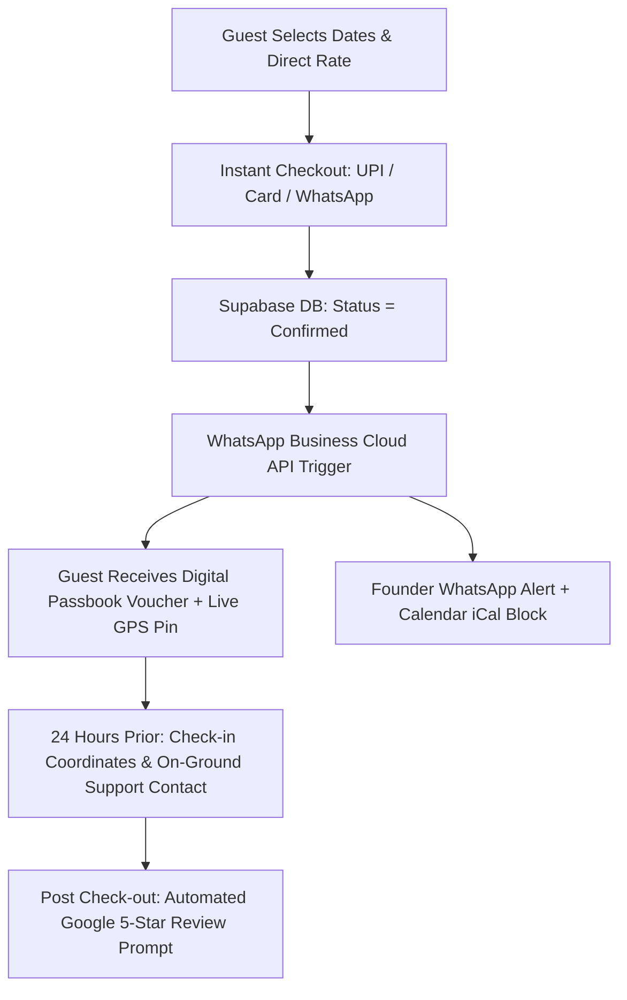
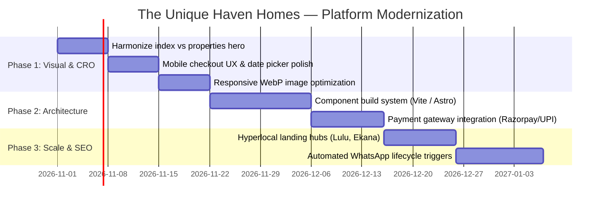

# 🏛️ The Unique Haven Homes — Industry Standard Engineering & Luxury UX Roadmap
> **Benchmark:** Airbnb Luxe · Sonder · Plum Guide · Aman Resorts · Marriott Bonvoy Direct  
> **Target:** Transform `uniquehavenhomesstay.com` into an internationally benchmarked, ultra-fast, high-conversion luxury hospitality portal.

---

## Executive Summary & Current State Audit

Your current platform has exceptionally strong **business fundamentals**:
- Authentic registered luxury hospitality brand (The Unique Haven Homes Pvt Ltd, CIN registered).
- Direct-booking price advantage (Save 15% vs Airbnb/MMT with zero convenience fees).
- Full portfolio coverage (18 residences across Gomti Nagar & Shaheed Path/Lulu Mall).
- WhatsApp-first Indian guest acquisition with real-time Supabase pricing integration.

However, to elevate this platform to the **global industry standards** of top hospitality tech brands, several architectural and user-experience bottlenecks must be modernized.

---

## 📊 Benchmark Comparison Matrix

| Dimension | Current Website State | Global Industry Standard (Aman / Sonder / Airbnb Luxe) | Gap Priority |
| :--- | :--- | :--- | :--- |
| **Architecture** | 18 static individual HTML files with duplicated headers/footers | Single template SSG (Vite / Astro / Next.js) or dynamic route with shared components | 🔴 High |
| **Hero & Navigation** | Both `index.html` and `properties.html` share identical full-screen slider | Homepage has narrative brand hero; Directory has curated search & map-first view | 🔴 High |
| **Asset Delivery** | Remote unoptimized images from Airbnb CDN (`muscache.com`) | Localized CDN (Cloudflare / Cloudinary) with responsive WebP/AVIF `srcset` | 🔴 High |
| **Booking Engine** | Manual redirect to `book.html` or WhatsApp | Embedded fluid date-picker, instant price breakdown & one-click checkout | 🟡 Medium |
| **Payment Stack** | UPI QR screenshot upload + WhatsApp slip | Integrated Razorpay / Cashfree PG + UPI Intent + International Cards | 🟡 Medium |
| **Design System** | Mixed CSS tokens and inline styles across multiple stylesheets | Tokenized design system (Tailwind / CSS Variables: `--color-bg-luxury`, typography scale) | 🟡 Medium |
| **Core Web Vitals** | Unbundled JS (195KB property engine, 484KB bookings), heavy inline DOM | Code-split modular bundles, lazy-loaded interactive widgets, LCP < 1.2s | 🟡 Medium |
| **SEO & Schema** | Partial `LodgingBusiness` JSON-LD | Comprehensive `VacationRental`, `BreadcrumbList`, `FAQPage`, localized landmark schema | 🟢 Ongoing |

---

## 🏛️ Pillar 1: Architecture & Codebase Modernization

### 1.1 The Single Source of Truth Problem
* **Current Bottleneck:** When you change a header link, logo animation, or caretaker policy, you currently have to edit 20+ separate HTML files (`index.html`, `properties.html`, and 18 individual property files).
* **Industry Standard Solution:**
  1. **Option A (Static Site Generation - Recommended):** Use **Astro** or **Vite SSG**. Write each component once (`<Navbar />`, `<BookingCard />`, `<Footer />`, `<ReviewModal />`). The build script generates lightning-fast static HTML for all 18 properties automatically.
  2. **Option B (Lightweight Vanilla Template):** Use a single `property.html` dynamic template that hydrates based on URL slug (`property.html?slug=the-luxe-haven`), with pre-rendered SEO fallback metadata generated via a lightweight build script.

### 1.2 Unifying `index.html` vs `properties.html`
* **Current Issue:** Both pages currently have the exact same large hero slider for Royal White House ("Come find your royal quiet"). Visitors switching between Home and Properties feel disoriented.
* **Industry Standard Fix:**
  - **`index.html` (Brand Flagship & Storytelling):** Large experiential hero video/slider, curated "Best of Lucknow" collections (Penthouses, Family Villas, Couple Friendly), Host Story, and guest social proof.
  - **`properties.html` (Exploration & Directory Engine):** Fast, map-and-card directory with sticky facet filters (Dates, Bedrooms, Localities, Amenities) and instant search. No duplicate 800px hero slider at the top.

---

## 🎨 Pillar 2: Luxury Hospitality Aesthetics & UI Craft

### 2.1 Restrained Typography System
Adopt an editorial typography pairing used by luxury boutique hotels:
- **Headings (Display):** *Playfair Display*, *Cinzel*, or *Cormorant Garamond* (warm, timeless, high-society editorial).
- **Body & Numerics (Functional):** *Plus Jakarta Sans* or *Inter* with tabular numbers (`font-variant-numeric: tabular-nums`) for currency and date displays.
- **Micro-Copy & Badges:** Monospace or tracking uppercase (`letter-spacing: 0.12em; text-transform: uppercase; font-size: 11px`).

### 2.2 Cohesive Architectural Color Palette
Replace harsh saturated buttons with warm, restrained architectural tones:
```css
:root {
  /* Surface Tones */
  --lux-bg-root: #0b0f17;          /* Midnight Onyx */
  --lux-surface-card: #131b26;     /* Deep Slate Architecture */
  --lux-surface-glass: rgba(19, 27, 38, 0.72);
  
  /* Brand Accents */
  --lux-gold-primary: #d4af37;     /* Authentic Royal Awadhi Gold */
  --lux-gold-muted: #b58d3d;
  --lux-emerald-accent: #10b981;   /* WhatsApp & Trust accents */
  
  /* Editorial Ink */
  --lux-text-primary: #f8fafc;
  --lux-text-secondary: #94a3b8;
  --lux-border-delicate: rgba(255, 255, 255, 0.08);
}
```

### 2.3 Micro-Interactions & Haptic Polish
- **Image Lightbox:** Smooth fluid expansion with pan-and-zoom and categorized tabs (Bedrooms, Living, Dining, Bathrooms).
- **Price Counter:** Smooth number-rolling micro-animation when dates change.
- **Date Picker:** Two-month dual calendar with disabled booked dates fetched directly from Airbnb iCal.

---

## ⚡ Pillar 3: Performance & Core Web Vitals (95+ Lighthouse Score)

### 3.1 Next-Gen Image Optimization
- Convert all static JPG/PNG property covers to modern **WebP** and **AVIF** formats.
- Implement responsive `srcset` (`240w`, `480w`, `720w`, `1200w`) so mobile phones download 45KB images instead of 1.2MB desktop covers.
- Set explicit `width` and `height` attributes on all image tags to eliminate Cumulative Layout Shift (CLS = 0).

### 3.2 JavaScript Bundling & Code Splitting
- Currently, CRM administrative files (`smart-bookings.js`, `whatsapp-hub.js`, `employee-ledger.js`) are stored in the same repository as the public guest website.
- **Recommendation:** Separate public visitor scripts from the private `/admin.html` dashboard. Bundle public JavaScript with Vite/esbuild into a single cached `< 40KB` asset.

---

## 💳 Pillar 4: Direct Booking Engine & Revenue Optimization (CRO)

### 4.1 Frictionless Booking Experience
- **Current Flow:** Guest clicks "Book Now" -> redirects to `book.html` -> fills form -> pays via manual UPI QR -> sends screenshot on WhatsApp.
- **Industry Standard Hybrid Flow:**
  1. **Inline Date Selection:** Select dates directly on the property card or property page.
  2. **Instant Price Transparency:** Show nightly rate, GST (12%), cleaning/host direct discount (-15%), and total payable.
  3. **Multi-Rail Checkout:**
     - **Domestic Guests (India):** UPI Deep-link (GPay / PhonePe / Paytm / BHIM) with instant transaction ID auto-capture.
     - **Corporate / NRI / Foreign Guests:** Razorpay / Cashfree gateway supporting Credit/Debit Cards & Net Banking.
     - **WhatsApp Fallback:** "Book via Host on WhatsApp" button for custom dates or personalized concierge requests.

### 4.2 Automated Booking Lifecycle


---

## 🔍 Pillar 5: Local SEO & Hyper-Targeted Discovery

Lucknow has strong localized hospitality queries driven by medical tourism, cricket matches, weddings, and corporate transit:

### 5.1 Programmatic Hyperlocal Landing Pages
Create lightweight SEO hubs targeting high-intent traveler searches:
- `/homestays-near-lulu-mall.html` (The Luxe Haven, Velvet House, Green Forest, Pink Paradise)
- `/villas-near-ekana-stadium.html` (Celebrity Garden, Royal White House, Gomti Grand Villa)
- `/homestays-near-medanta-hospital.html` (Patient & family-friendly serviced flats)
- `/group-villas-lucknow-weddings.html` (Large residences accommodating 12–18+ guests)

### 5.2 Schema.org Rich Snippets
Embed structured JSON-LD data on every page:
```json
{
  "@context": "https://schema.org",
  "@type": "VacationRental",
  "name": "Royal White House",
  "identifier": "VIL-102",
  "address": {
    "@type": "PostalAddress",
    "streetAddress": "Omaxe City, Shaheed Path",
    "addressLocality": "Lucknow",
    "addressRegion": "UP",
    "postalCode": "226025",
    "addressCountry": "IN"
  },
  "containsPlace": {
    "@type": "Accommodation",
    "numberOfBedrooms": 4,
    "occupancy": {
      "@type": "QuantitativeValue",
      "maxValue": 18
    }
  },
  "aggregateRating": {
    "@type": "AggregateRating",
    "ratingValue": "4.95",
    "reviewCount": "48"
  }
}
```

---

## 🔒 Pillar 6: Security, Compliance & Data Governance

1. **Supabase Row Level Security (RLS):**
   - Ensure `anon` public key only has read permissions to public property rates, photos, and published reviews.
   - Restrict guest registers, employee tables, financial ledgers, and cashbooks behind authenticated JWT admin roles.
2. **PII Protection:**
   - Keep guest phone numbers, Aadhaar card uploads, and private caretaker details securely encrypted in Supabase storage buckets with signed expiring URLs (15-minute TTL).
3. **Official Corporate Transparency:**
   - Continue highlighting MCA CIN (`U55101UP2026PTC244637`) and GST compliance in the footer to instill 100% booking confidence.

---

## 🚀 Phased Implementation Roadmap



---
*Created for: Praveen Singh & Founders Mr. Shahanshah & Mr. Firoz Khan · The Unique Haven Homes Private Limited*
