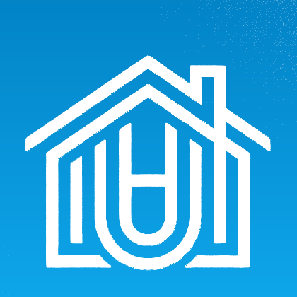

  
  <h1>The Unique Haven Homes</h1>
  
<strong>Enterprise Hospitality Operations, Property Management & Guest CRM System</strong>

  

    
    
    
    
  

---

## 🌟 Overview

**The Unique Haven Homes (TUHH)** is an end-to-end, full-stack enterprise hospitality and property operations management platform engineered for luxury serviced residences, homestays, and boutique short-term rental portfolios.

Built with a mobile-first Progressive Web Application (PWA) architecture and packaged as a native Android Trusted Web Activity (TWA), the platform unifies real-time OTA reservation synchronization, multi-property housekeeping, employee payroll, automated guest communications, and financial auditing into a single executive dashboard.

---

## ✨ Core Features

### 📅 1. Multi-Calendar & OTA Synchronization
- **Real-Time Airbnb iCal Sync**: Bidirectional automated synchronization of reservations, blockings, and guest schedules across 19 premium apartments.
- **Smart Booking Engine**: Direct booking creation, nightly price calculators, advance deposit management, and seasonal rate cards.
- **Digital Guest Check-In**: Instant WhatsApp registration, check-in details, Wi-Fi credentials, and keycode delivery.

### 🏢 2. Multi-Property & Asset Directory
- **Unified Inventory**: Real-time status tracking (Occupied, Vacant, Clean, Dirty, Under Maintenance).
- **Amenities & Keyless Access**: Master property inventory, digital lock codes, caretaker assignments, and Google Maps location pins.
- **High-Converting Guest Showcase**: Integrated direct-booking guest directory with luxury typography and image galleries.

### 🧹 3. Housekeeping & Facility Operations
- **Real-Time Housekeeping Queue**: Instant cleaning task assignment triggered automatically upon guest check-out.
- **Dynamic Task Tracking**: Per-flat piece rate vs. fixed salary basis for housekeeping personnel.
- **Inspection & Cleanliness Verification**: Photo audit uploads and flat readiness certification.

### 💰 4. HRMS, Staff Attendance & Payroll
- **Dual Payroll Engine**: Native computation supporting both Per-Flat cleaners (Piece-Rate) and Fixed Monthly administrative staff.
- **Advance & Expense Settlement**: Automated deduction of cash advances and operational spends against monthly earnings.
- **Executive Salary Vouchers**: One-click generation of formal PDF Salary Slips and consolidated monthly payroll statements.

### 🧾 5. Billing, Invoicing & Financial Intelligence
- **Corporate GST Invoicing**: Formal B2B & B2C tax invoice generation compliant with Indian GST standards.
- **Comprehensive Expense Hub**: Category-wise expenditure logging (Maintenance, Wi-Fi, Linens, Staff Spends, Vendor Payments).
- **Executive Cashflow Analytics**: Real-time profit and loss (P&L), gross earnings, occupancy metrics, and audit exports (CSV / Excel).

---

## 📱 Mobile App (Android TWA)

The Unique Haven Homes CRM is available as an installable full-screen Android application powered by Google Trusted Web Activities (TWA):

- **Zero URL Bar**: True native application interface with custom launch splash and digital asset link verification.
- **Offline Reliability**: Service worker caching engine providing seamless offline navigation.
- **Bottom Navigation**: Ergonomic bottom navigation designed for single-hand mobile operations.

📥 **Download Latest Android APK:** [GitHub Releases v1.0.0](https://github.com/airbnbmanager/airbnbmanager.github.io/releases/latest)

---

## 🛡️ Enterprise Security & Privacy

- **Role-Based Access Control (RBAC)**: Strict segregation of duties across Administrator, Host, Housekeeping Staff, and Investor profiles.
- **Secure Document Storage**: Private cloud storage buckets with time-limited signed URLs for guest verification.
- **Encrypted Audit Logs**: Comprehensive logging of user sessions, status updates, and financial ledger modifications.

---

## 🏛️ Corporate Identity

**The Unique Haven Homes Private Limited**  
- **CIN**: `U55101UP2026PTC244637`  
- **GSTIN**: `09AAMCT8448C1ZX`  
- **Registered Office**: Blossom Skyline, Vikalp Khand, Gomti Nagar, Lucknow, Uttar Pradesh, 226010  
- **Official Web Portal**: [uniquehavenhomesstay.com](https://uniquehavenhomesstay.com)  

---

  © 2026 The Unique Haven Homes Private Limited. All Rights Reserved. Confidential & Proprietary.

