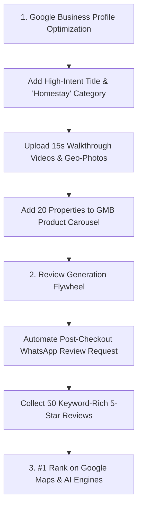

# 🚀 GOOGLE MAPS & AI SEARCH #1 RANKING PLAYBOOK
**The Unique Haven Homes Private Limited**  
*Master Strategy for Dominating Google Search, Google Maps 3-Pack, and Generative AI (Gemini, ChatGPT, Perplexity)*  
*Public Face & Host Contact: Shahanshah (+91 9450055554)*

---

## 🎯 1. Executive Summary & The "Monu Prajapati" Ranking Case Study

In local search, Google’s algorithm does not care about fancy marketing words; it ranks profiles based on **Relevance, Prominence, and Proximity**.

### 🔍 Breakdown of the #1 Ranked Lucknow Profile (Inspection from Live Search):
When searching *"plumber in lucknow near me home service"*, the profile **"All plumbering service Monu Prajapati"** captured position #1 above large corporate directories because of 4 algorithmic triggers:
1. **Keyword in Business Title**: Included the primary high-intent search term (`plumbering service`) directly in the GMB title.
2. **Review Velocity & Rating**: **157 Reviews at 4.9★** with rich customer review snippets (*"Quick, efficient neat n clean service, polite, soft spoken person"*).
3. **Verified Walkthrough Video**: Uploaded a live 18-second video (`0:18`) proving real-world operational legitimacy.
4. **Active Hours & Fast Response**: Marked **Open 24 hours** with instant 1-tap calling.

### 🏆 Applying This Directly to The Unique Haven Homes:
To rank #1 for:
- *"best homestay in lucknow"*
- *"luxury homestay gomti nagar"*
- *"villa in lucknow for family / wedding"*
- *"airbnb in lucknow near lulu mall / ekana stadium"*
- *"serviced 3bhk apartment lucknow"*

We replicate and exceed these exact mechanics across **Google Business Profile (GBP)**, **On-Page SEO**, and **Generative Engine Optimization (GEO)**.

---

## 📍 2. Google Business Profile (GBP) #1 Ranking Blueprint

### Step 1: Optimized Business Title & Categories
* **Primary Listing Title**:  
  `The Unique Haven Homes — Luxury Homestays & Serviced Villas Lucknow`  
  *(Note: Includes Brand Name + Core High-Volume Search Keywords).*
* **Primary Category**: `Homestay` (or `Serviced accommodation`)
* **Secondary Categories**:
  - `Holiday home`
  - `Villa`
  - `Corporate housing service`
  - `Hotel`
  - `Extended stay hotel`
* **Primary Phone Number**: `+91 9450055554` (Mr. Shahanshah)
* **Website URL**: `https://uniquehavenhomesstay.com`
* **Appointment / Catalog URL**: `https://wa.me/c/919194109911`

### Step 2: Service Areas & Address Pin Placement
* **Primary Address**: Official Head Office & Hub (Vikalp Khand / Gomti Nagar, Lucknow - 226010).
* **Service Areas Covered**:
  - Gomti Nagar, Lucknow
  - Chinhat, Lucknow
  - Shaheed Path, Lucknow (Near Lulu Mall & Ekana Stadium)
  - Indira Nagar, Lucknow
  - Hazratganj, Lucknow

### Step 3: Uploading the 20 Properties as "GMB Products"
Google Maps displays a visual carousel of "Products" directly on mobile search results.
For each of TUHH's 20 luxury properties:
1. **Product Name**: e.g., `Royal White House — 4 BHK Luxury Villa`
2. **Category**: `Luxury Villas & Homestays`
3. **Price**: `₹12,000` (or starting rate)
4. **Description**:
   - 4 King Bedrooms with Ensuite Bathrooms
   - Private Courtyard & Lush Lawn
   - 100% Family Privacy with Dedicated Caretaker
   - Located in Gomti Nagar Lucknow
5. **Button / URL**: `Order Online` -> `https://uniquehavenhomesstay.com/royal-white-house.html`

### Step 4: Video Uploads (The Secret Ranking Factor)
* Record a 15–25 second vertical mobile walkthrough video for each property cluster:
  - Video 1: Grand Luxury Villas (Royal White House lawn & living room).
  - Video 2: Gomti Nagar 3BHK Homestay (Spacious hall, master bedroom, modular kitchen).
  - Video 3: Blossom Skyline / Shaheed Path (Balcony view & contemporary interior).
* Upload these under GMB -> **Photos & Videos** -> **Videos**. Google favors listings with video proof!

---

## ⭐ 3. The Review Velocity Flywheel (Road to 100+ 5-Star Reviews)

Reviews are the single biggest ranking factor for the Google 3-Pack. We need at least 40–50 reviews within 60 days.

### Automated WhatsApp Checkout Trigger
At **11:30 AM** on the morning of check-out, the CRM / WhatsApp Bot sends this message:

```text
Namaste [Guest Name] ji 🙏,

Thank you for choosing The Unique Haven Homes for your stay in Lucknow! It was a pleasure hosting you at [Property Name].

Could you take 15 seconds to support our family-run homestay with a 5-star Google review? Your feedback helps fellow travelers find safe, clean, and luxurious stays in Lucknow.

⭐ Leave a Quick Review Here:
👉 [YOUR_GOOGLE_REVIEW_SHORTLINK]

(If you can mention the cleanliness, the location in Gomti Nagar, or the service by Mr. Shahanshah, that would mean the world to us!)

Safe travels and see you again soon in Lucknow! 🌸
```

### The Keyword Review Hack
When guests mention specific words in their reviews like *"best homestay in lucknow"*, *"very clean 3bhk"*, or *"peaceful villa in gomti nagar"*, Google Maps creates bold review snippets (just like it did for Monu Prajapati: *"Quick, efficient neat n clean service"*).

---

## 🤖 4. Generative AI Search Optimization (GEO for Gemini & ChatGPT)

When modern high-net-worth travelers ask AI assistants:
- *"Gemini, find me the best luxury villa in Lucknow for a wedding family"*
- *"ChatGPT, what is the best homestay in Gomti Nagar with 3 bedrooms?"*
- *"Perplexity, find private luxury Airbnb stays near Ekana Stadium Lucknow"*

### How AI Recommends The Unique Haven Homes:
1. **Schema.org Structured Data**:
   Our website features comprehensive `LodgingBusiness`, `VacationRental`, `FAQPage`, and `Person` (Shahanshah) structured data.
2. **AI Knowledge Files (`llms.txt` and `llms-full.txt`)**:
   Already live on `https://uniquehavenhomesstay.com/llms.txt`. When AI bots crawl the web, this file directly provides structured facts about all 20 properties, pricing, and owner contact (+91 9450055554).
3. **Entity Consistency (NAP)**:
   - **N**ame: The Unique Haven Homes Private Limited
   - **A**ddress: Gomti Nagar & Shaheed Path, Lucknow, Uttar Pradesh 226010
   - **P**hone: +91 9450055554 (Shahanshah)
   When NAP is 100% consistent across Google, Website, Airbnb, and WhatsApp, AI models treat TUHH as a verified authority entity.

---

## 📋 5. Local Citation & Backlink Checklist

To push the domain authority and local prominence above competitors:

| Platform | Listing Name | Phone | Target Category | Status |
| :--- | :--- | :--- | :--- | :--- |
| **Google Business Profile** | The Unique Haven Homes — Luxury Homestays Lucknow | +91 9450055554 | Homestay | 🟡 High Priority |
| **WhatsApp Business** | The Unique Haven Homes (Catalog) | +91 9194109911 | Vacation Home Rental | 🟢 Active |
| **Airbnb Superhost Profile** | The Unique Haven Homes | Verified Host | Homestay / Villa | 🟢 Active (4.9★) |
| **Justdial Lucknow** | The Unique Haven Homes Pvt Ltd | +91 9450055554 | Homestay / Serviced Apartment | 🟡 Free Listing |
| **IndiaMART** | The Unique Haven Homes Pvt Ltd | +91 9450055554 | Corporate Stays / Serviced Flats | 🟡 Free Listing |
| **Tripadvisor** | The Unique Haven Homes Lucknow | +91 9450055554 | Vacation Rentals Lucknow | 🟡 Submit Property |
| **MakeMyTrip / Goibibo** | The Unique Haven Homes Network | +91 9450055554 | Homestays Lucknow | 🟡 Listing Sync |

---

## 🎯 6. Immediate Step-by-Step Action Plan



1. **Step 1**: Open your Google Business Profile Manager (`business.google.com`).
2. **Step 2**: Update Title to:  
   `The Unique Haven Homes — Luxury Homestays & Serviced Villas Lucknow`
3. **Step 3**: Verify primary phone is set to `+91 9450055554` (Mr. Shahanshah).
4. **Step 4**: Upload 3 vertical video walkthroughs (15-20 seconds each).
5. **Step 5**: Create the 20 GMB Products linked directly to your property pages or WhatsApp catalogue.
6. **Step 6**: Send the Google Review link to the last 20 happy guests on WhatsApp today!
